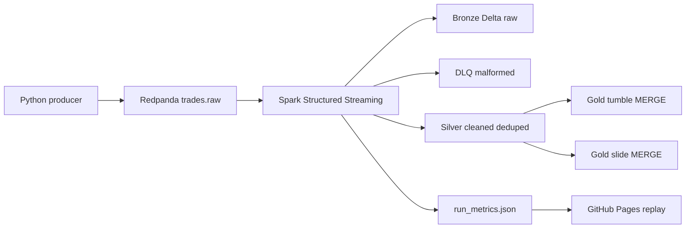

# Real-Time Event Streaming Pipeline

I built this as a portfolio project to show how I design a small but complete streaming path: produce trade events, buffer them on a Kafka-compatible broker, clean and aggregate them in Spark Structured Streaming, and land bronze / silver / gold tables in Delta Lake.

Live replay dashboard: https://rahul9121.github.io/realtime-event-streaming/

The dashboard is a **replay of a recorded run**, not a live cluster.

## What it does

- Python producer emits seeded synthetic trades (duplicates, late arrivals, malformed payloads are controllable).
- Redpanda (Kafka API) holds topic `trades.raw` with 3 partitions.
- Spark Structured Streaming:
  - defined JSON schema
  - malformed rows to a Delta dead-letter path
  - 30s watermark, late data handling
  - `dropDuplicates` on `event_id`
  - 10s tumbling windows and 30s / 10s sliding windows
  - checkpoint directories per query
  - `foreachBatch` + Delta `MERGE` into gold
- Run metrics written to `dashboard/run_metrics.json` for the static replay UI.

## Architecture



## Run in 3 commands

```bash
pip install -r requirements.txt
docker compose up -d
# create topic (also done by make up)
docker exec res-redpanda rpk topic create trades.raw -p 3 -r 1
```

Then in two terminals:

```bash
python -m src.producer.generate_events --broker localhost:19092 --seconds 30 --rate 50
python -m src.streaming.job --broker localhost:19092 --max-seconds 90
```

Or use the Makefile (Git Bash / make on PATH):

```bash
make up
make produce
make stream
```

Offline record + local dashboard (no broker required):

```bash
python -m src.streaming.record_run --seconds 45 --output dashboard/run_metrics.json
python -m http.server 5500 --directory dashboard
```

Open http://localhost:5500

## Tests

```bash
python -m pytest tests -q
```

## CI note

GitHub Actions runs unit tests and a **file-source** end-to-end recorder. I deliberately do **not** start Kafka/Redpanda in CI. Broker bring-up on shared runners is flaky and slow for a portfolio build under 15 minutes. The same parsing, dedupe, window, and metrics path is exercised against generated JSONL. Locally you can run the full Redpanda + Spark path.

Pages deploy publishes the `dashboard/` folder (HTML + `run_metrics.json`).

## Real results (recorded run)

From `dashboard/run_metrics.json` (seed 42, 45s-equivalent volume at 50 eps target, lightweight recorder + same parse/dedupe/window logic as the job):

| Metric | Value |
| --- | --- |
| Wire events | 2374 |
| Valid events | 2276 |
| After dedupe | 2152 (124 duplicates dropped) |
| Malformed / DLQ path | 98 |
| Late beyond 30s lag | 225 |
| Tumbling symbol-windows | 124 |
| Recorder wall clock | 0.313 s |
| Avg batch duration | 1.04 ms |

Per-symbol trades after dedupe (tumble inputs): NVDA 296, GOOG 282, TSLA 275, AMZN 268, JPM 264, AAPL 258, MSFT 257, META 252.

The dashboard footer shows the same summary. Re-run `python -m src.streaming.record_run` to refresh.

## Delivery semantics (honest)

- Producer uses `acks=all` to Redpanda.
- Spark Kafka source + checkpointing gives **at-least-once** processing for each query. If a micro-batch fails after a sink write but before offset commit, that batch can be replayed.
- Gold uses Delta `MERGE` on `(symbol, window_start, window_end)` so replays **upsert** aggregates instead of blind appends. That is idempotent for the gold grain I chose, not full end-to-end exactly-once across every sink.
- Bronze/silver append sinks can still see duplicates under retry unless you add stronger idempotency (for example merge-on-event_id for silver).
- There is **no schema registry**. Schema is enforced in code and in Spark `from_json`.

## Layout

```
src/producer/          synthetic events -> Kafka or file
src/streaming/job.py   Spark bronze/silver/gold + DLQ
src/streaming/record_run.py   metrics for dashboard / CI
src/common/            schema + pure aggregations (tested)
dashboard/             static replay UI
docker-compose.yml     Redpanda + console
```

## Limitations

- Single-node Spark `local[2]` and one Redpanda broker.
- Simulated trades only. No market data vendor, no API keys.
- No Schema Registry / Avro.
- Small-file pressure is real if you run long; production would compact and tune trigger intervals.
- Watermark is 30 seconds for demo scale, not a production SLA.
- Checkpoint recovery works when you restart with the same checkpoint path; I do not automate multi-node failure testing here.

## License

MIT
